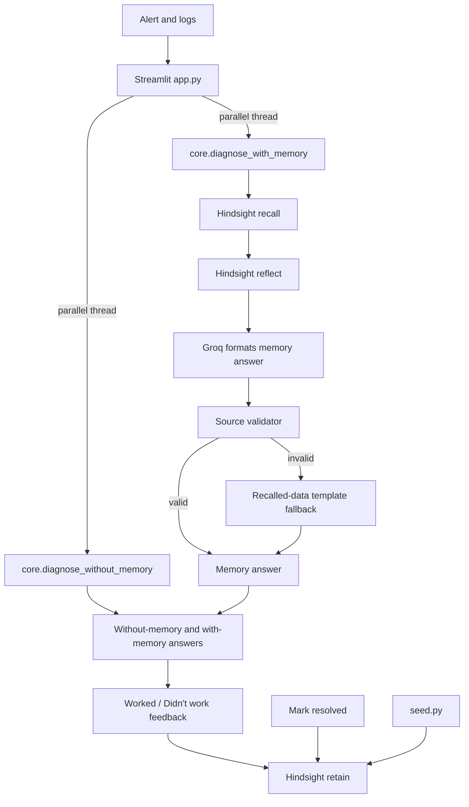

# OnCall Memory

On-call engineers often debug the same incidents again because prior fixes are hard to find.
OnCall Memory uses Hindsight to retain resolved incidents and retrieve relevant history for new alerts.
It shows the recalled incident and recorded fix alongside a diagnosis, so engineers can inspect the source before acting.

## What it does

- Compares a diagnosis with and without incident memory.
- Shows recalled incidents, a best-match card, and a heuristic confidence label.
- Saves resolved postmortems and Worked / Didn't work feedback to Hindsight.
- Includes a held-out evaluation script and five offline core tests.

## Demo walkthrough (about 2 minutes)

Start the app using the setup steps below. Paste an alert and click **Diagnose** with Memory OFF, then turn Memory ON and diagnose the same alert. The app caches each result by alert text, so switching modes reuses the side already computed. The alerts below come from held-out cases whose saved evaluation rows have a correct root-cause verdict and recalled IDs that overlap the relevant incident IDs.

**Example alerts:** Use the **Try an example** dropdown above the alert box to load TEST-02, TEST-04, or a novel case with no relevant history. The examples are loaded from `data/test_incidents.json`.

**Example 1 — TEST-02**

```text
After Redis promotion, auth requests time out to 10.4.8.12; redis.exceptions.ConnectionError: connection refused; new primary is healthy.
```

**Example 2 — TEST-04**

```text
invoice-api intermittently returns SQLSTATE 40P01; deadlock graph shows settlement locks invoice then payment while adjustment locks payment then invoice.
```

For each alert:

1. Compare the **Without memory** and **With memory** answers.
2. In the With-memory column, inspect **Best match**: it shows an incident ID, service, root cause, fix, and High / Medium / Low confidence. The label is a heuristic based on the cited incident and recall order.
3. Click **Worked** or **Didn't work** under the memory answer. Optionally enter a note first. A success message confirms the feedback record was retained.
4. Open **What the agent learned** and click **Reflect now** to request a Hindsight reflection on the current alert.
5. At the bottom, enter the root cause and fix under **Mark resolved**, then click **Save postmortem**.

## How Hindsight memory is used

The app stores records in the `oncall-v3` bank.

- **Retain:** `seed.py:build_incident_document()` formats the 40 synthetic postmortems, and `seed.py:main()` retains them with stable incident IDs. In `app.py`, the **Mark resolved** form calls `Hindsight.retain()` with a timestamp-based unique incident ID and the same text field layout. The **Worked / Didn't work** buttons also call `retain()` with a `feedback-<timestamp>` document ID and the alert, suggested fix, cited incident, outcome, and note.
- **Recall:** `core.py:_recall_with_timeout()` calls `Hindsight.recall()` for the new alert, parses incident fields, and separates feedback records from incident records.
- **Reflect:** `core.py:_recall_with_timeout()` calls `Hindsight.reflect()` before `compress_reflection()` builds the memory answer. The **Reflect now** control in `app.py` calls `core.reflect_now()` directly.
- **Other banks:** `eval/run_eval.py` evaluates the main `oncall-v3` bank and can seed `oncall-eval-10` and `oncall-eval-20`. `oncall-eval-0` is the empty-bank learning-curve point.

## Architecture



In `app.py`, the no-memory diagnosis and full memory diagnosis run concurrently. The memory path in `core.py` recalls incidents and feedback, obtains reflection, asks Groq to format an answer, and validates cited IDs and the cited fix against recalled fields. Invalid answers use a deterministic template filled from recalled data. The Best match card derives its confidence heuristic from the displayed citation and recall order.

### File map

- `app.py` — Streamlit controls, parallel execution, cached results, feedback, reflection, and resolved postmortem form.
- `core.py` — Groq prompts and fallback logic, Hindsight recall/reflect, extraction, validation, and diagnosis functions.
- `seed.py` — shared incident document template and seed CLI.
- `data/incidents.json` — 40 synthetic incidents.
- `data/test_incidents.json` — 10 held-out cases and expected root cause, fix, and relevant incident IDs.
- `eval/run_eval.py` — LLM-judged and retrieval evaluation; writes summaries, charts, and per-incident results under `eval/results/`.
- `eval/results/` — saved JSON, CSV, and chart outputs from an evaluation run.
- `tests/test_core.py` — five unit tests that mock external calls.
- `requirements.txt` — Python dependencies.
- `.env.example` — environment variable names and local Hindsight URL example.
- `screenshots/` — UI screenshots.

## Setup from a clean clone

Python 3.10 or newer is needed (the code uses Python 3.10 type syntax).

### Windows PowerShell

```powershell
python -m venv .venv
.\.venv\Scripts\Activate.ps1
pip install -r requirements.txt
Copy-Item .env.example .env
```

### macOS or Linux

```bash
python3 -m venv .venv
source .venv/bin/activate
pip install -r requirements.txt
cp .env.example .env
```

Edit `.env`:

- `HINDSIGHT_URL` — base URL of your Hindsight service. `.env.example` uses `http://localhost:8888` for a local service. For Hindsight Cloud, use the endpoint URL shown for your Cloud deployment.
- `HINDSIGHT_API_KEY` — API key for deployments that require authentication. Obtain it from your Hindsight deployment or Cloud account settings. Leave blank if your service does not require a key.
- `GROQ_API_KEY` — key for Groq API access, available from your Groq account/API console.
- `HINDSIGHT_TIMEOUT` — optional timeout in seconds for Hindsight calls in `core.py`; defaults to 15 seconds in the app. The eval sets it to 90 seconds.

Seed the production bank, then start Streamlit:

```text
python seed.py
streamlit run app.py
```

`seed.py` prints progress and a final retained/failed summary. Runtime depends on the Hindsight endpoint; a full 40-record seed may take roughly 2–3 minutes. For a smaller connection check, use `python seed.py --limit 2`.

## How to use the app

- **Memory ON/OFF** — controls whether the new alert is sent through the memory diagnosis path. The no-memory answer is still shown for comparison.
- **Paste a new incident** — enter the alert and log text.
- **Diagnose** — computes missing answers for that alert. Results are cached in Streamlit session state by exact alert text; changing the memory toggle does not recompute an answer already cached for that alert.
- **Best match** — shows the cited recalled incident when its fields are available. High means the cited incident is first in recall order; Medium means it is validated but later; Low means no valid close citation was found. This is a heuristic, not a calibrated probability.
- **Worked / Didn't work** — retains feedback about the current memory answer. The note is optional.
- **Recalled memories / Raw recalled facts** — show extracted incidents and the source text returned by recall.
- **What the agent learned → Reflect now** — asks Hindsight to reflect on the current alert and displays its response.
- **Mark resolved → Save postmortem** — retains the current alert, entered root cause, and fix with a unique document ID.

## How to check everything works

Run the offline unit tests:

```text
pytest
```

Expected: **5 passed**. These tests mock Hindsight and Groq-facing logic; they do not require network access.

Check the seed connection with a small subset, then run the app and diagnose one of the example alerts above:

```text
python seed.py --limit 2
streamlit run app.py
```

A successful seed prints per-record progress and its retained/failed summary. The app should show both diagnosis columns; memory recall needs a reachable Hindsight service, and Groq answers need a valid API key.

Evaluation commands:

```text
python eval/run_eval.py
python eval/run_eval.py --seed --full
python eval/run_eval.py --rejudge
python eval/run_eval.py --limit 1
```

The quick run compares Memory OFF and Memory ON using `oncall-v3`, and evaluates the N=0 and N=40 learning-curve points. `--seed --full` seeds the N=10 and N=20 banks, verifies a recalled incident's root cause and fix, and adds those curve points. `--rejudge` reuses saved answers in `results.json` and reruns the judges. `--limit N` uses the first N held-out incidents. `--workers N` controls concurrent test cases (default 2).

- **Retrieval hit** — for recurring cases, whether recall includes any expected relevant incident ID. For novel cases, whether the answer says no closely matching past incident.
- **Root cause correct** — Groq judge verdict on semantic agreement with the expected root cause.
- **Fix score** — Groq judge score from 1 to 5 against the expected fix.
- **Latency** — elapsed time for a test run, including diagnosis and judge work.

Results are written to `eval/results/results.json` and `eval/results/per_incident.csv`. The two charts are `eval/results/on_vs_off.png` and `eval/results/learning_curve.png`. Judge verdicts and reasons are included for review; scores are not an independent ground truth.

## Evaluation results

Quick mode evaluated 10 held-out synthetic incidents, with 0 errored runs.

| Mode | Root cause | Fix score (judge) | Retrieval hit |
|---|---:|---:|---:|
| Memory OFF | 10/10 | 38/50 (avg 3.8/5) | n/a |
| Memory ON (40 incidents) | 8/10 | 34/50 (avg 3.4/5) | 9/10 |

Learning curve (Memory ON):

- 0 incidents: root cause 0/10 because the answer says “no closely matching incident” instead of guessing; retrieval 2/10.
- 40 incidents: root cause 8/10; retrieval 9/10.
- N=10 and N=20 points were not run.


### Interpretation

Memory did **not** beat a plain LLM on root-cause accuracy or fix score in this test. The synthetic root causes are common, so an LLM may guess them well, while memory answers are constrained to recalled data. The value shown here is traceability (the answer names a past incident and its recorded fix), 9/10 retrieval, and accuracy rising as memory grows.

Caveats: only 10 test cases, synthetic data, an LLM judge, and a single run. There are no confidence intervals.

## Known limitations

- The incident data is synthetic.
- The assistant suggests fixes; it does not apply them.
- Novel incidents have no history to draw on.
- The best match can be wrong. For example, an alert about HikariPool exhaustion on `db-primary` matched a Redis failover incident instead of a connection-pool incident in one run.
- Answers sometimes use the recalled-data template after source validation fails.
- Confidence is a heuristic, not a calibrated measure.

## Troubleshooting

- **Hindsight timeout:** check that `HINDSIGHT_URL` is reachable and that the service is responding. For a slow service, increase `HINDSIGHT_TIMEOUT`; the app default is 15 seconds. The eval sets it to 90 seconds.
- **`Bank not found (404)` for an empty eval bank:** expected for the N=0 learning-curve point; it represents zero recalled memories.
- **`Recalled incident ... missing fields` warning:** a recalled result did not contain one or more fields expected by the parser. Check the retained text and metadata template in `seed.py` and ensure the bank has been seeded with current records.
- **Groq rate limits:** the eval retries transient judge failures with backoff. Reduce `--workers` or retry later if limits continue.
- **PowerShell does not accept `&&` in some versions:** run each setup or run command on its own line.
- **Unclosed `aiohttp` session warning:** can appear during shutdown from a dependency; it does not necessarily mean the completed request failed. Confirm the displayed operation result and check the recorded error fields if present.

## Roadmap

- Improve memory-answer quality and reduce validator fallbacks.
- Improve recall ranking and best-match selection.
- Run the full learning curve, including N=10 and N=20.
- Build a Slack bot.
- Evaluate with real postmortem data.

## Path to adoption (PLANNED, not built)

- Ingest postmortems from existing documents and tools.
- Receive alerts through a PagerDuty or Opsgenie webhook.
- Reply in the incident's Slack thread.
- Use Worked / Didn't work feedback buttons as the learning signal.
