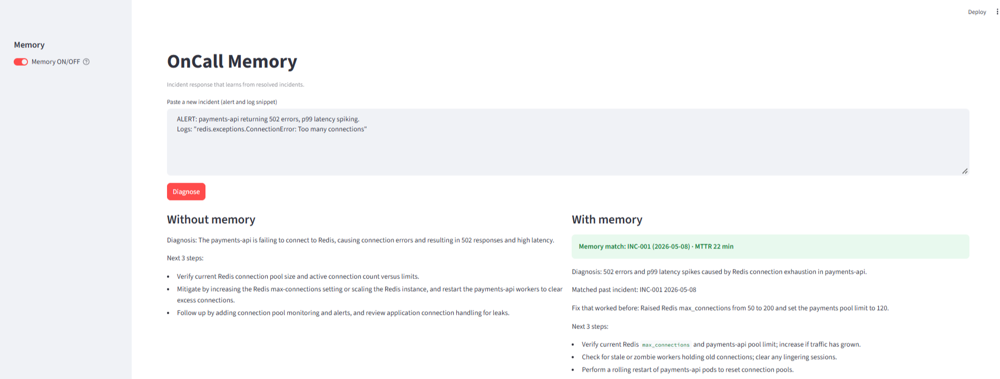
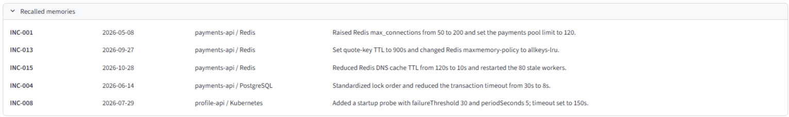
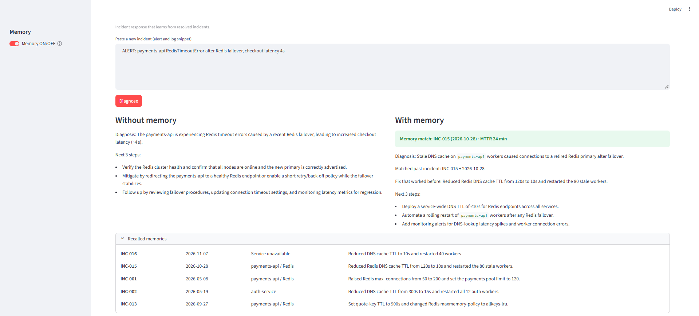

# OnCall Memory

OnCall Memory is a lightweight incident-response assistant. It diagnoses pasted alerts and log snippets with Groq, then uses Hindsight as long-term memory so resolved incidents can inform future responses.

## Screenshots

**1. Memory OFF vs ON (INC-001 match)**



**2. Recalled memories**



**3. Learning: a newly saved incident recalled**



## Architecture

```text
                         +--------------------+
 Incident alert/logs --->| Streamlit interface |
                         +----------+---------+
                                    |
                     +--------------+--------------+
                     |                             |
              Memory OFF                    Memory ON
                     |                             |
                     |                    +--------v---------+
                     |                    | Hindsight recall |
                     |                    | + reflection     |
                     |                    +--------+---------+
                     |                             |
                     +--------------+--------------+
                                    v
                           +--------+--------+
                           | Groq diagnosis  |
                           | primary + retry |
                           | fallback model  |
                           +--------+--------+
                                    |
                         diagnosis and comparison
                                    |
                  resolved root cause + fix applied
                                    v
                           Hindsight retain
```

## How Hindsight memory is used

The app connects with `Hindsight(base_url=HINDSIGHT_URL)` and includes `HINDSIGHT_API_KEY` when configured. All incident memory is stored in the `oncall-v3` bank, separate from the original seed data.

- **retain** — “Mark resolved” saves the original alert/log snippet together with an incident ID, date, root cause, and exact fix. `seed.py` retains 15 synthetic postmortems with stable IDs, event timestamps, and metadata. Re-running the seed script updates those documents by ID instead of duplicating them.
- **recall** — With memory enabled, the app searches for incidents relevant to the current alert and logs before producing the memory-enriched diagnosis. Memory OFF does not perform a recall. Each recalled record is displayed with its ID, date, and text.
- **reflect** — The app uses Hindsight's reflection as the source for the memory-informed answer, then asks Groq to format it using only that reflection and recalled memories. Incident IDs not present in the recall results are rejected.

Before any matching postmortem is retained, a diagnosis of a Redis timeout may only suggest checking connectivity and service health. After retaining a resolved incident that links `RedisTimeoutError` to clients pinned to an old primary after failover, the next similar incident can include that prior cause and the endpoint-refresh fix in its memory-enriched answer.

The diagnosis page compares a short, generic Groq answer against one informed by Hindsight. The memory answer is limited to incident IDs returned by recall. The open-by-default “Recalled memories” expander shows up to five deduplicated incidents; the full raw fact list is available in a second, collapsed expander.

## Setup and run

Python 3.10 or newer is recommended.

1. Create and activate a virtual environment.
2. Install dependencies:

   ```bash
   pip install -r requirements.txt
   ```

3. Copy `.env.example` to `.env` and set `HINDSIGHT_URL`, `HINDSIGHT_API_KEY` (if required by your Hindsight deployment), and `GROQ_API_KEY`.
4. Start Streamlit:

   ```bash
   streamlit run app.py
   ```

5. To load the sample incidents into the configured Hindsight server, run:

   ```bash
   python seed.py
   ```

`seed.py` retains its sample incidents each time it runs. The app itself uses no local database; Hindsight is the only persistent memory store.
