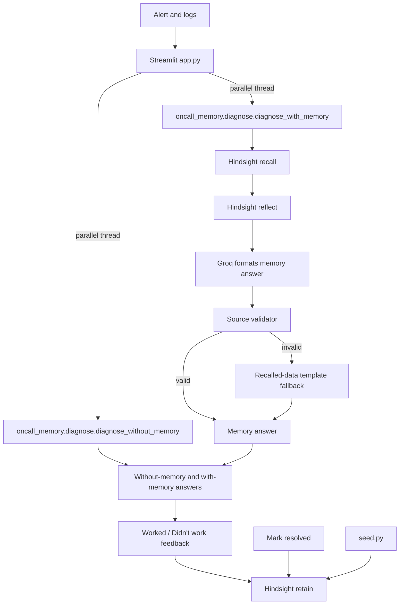
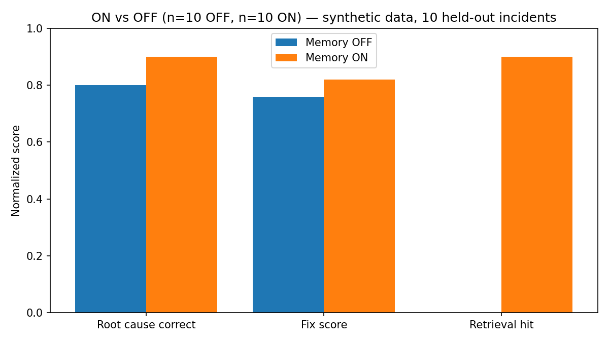
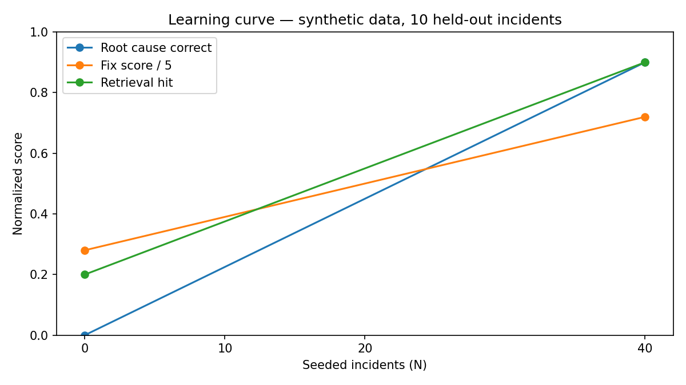

# OnCall Memory

On-call engineers often debug the same incidents again because prior fixes are hard to find.
OnCall Memory uses Hindsight to retain resolved incidents and retrieve relevant history for new alerts.
It shows the recalled incident and recorded fix alongside a diagnosis, so engineers can inspect the source before acting.

## What it does

- Compares a diagnosis with and without incident memory.
- Shows recalled incidents, a best-match card, and a heuristic confidence label.
- Saves resolved postmortems and Worked / Didn't work feedback to Hindsight.
- Includes Memory Insights, feedback learning, and confirmed supersession records.
- Includes offline unit tests and proof scripts for feedback and supersession behavior.

All incident data in this project is synthetic. We do not claim to outperform commercial incident tools.

## Demo walkthrough (about 2 minutes)

Start the app using the setup steps below. Paste an alert and click **Diagnose** with Memory OFF, then turn Memory ON and diagnose the same alert. The app caches each result by alert text, so switching modes reuses the side already computed. The alerts below come from held-out cases whose saved evaluation rows have a correct root-cause verdict and recalled IDs that overlap the relevant incident IDs.

**Example alerts:** Use the **Try an example** dropdown above the alert box to load TEST-02, TEST-04, or a novel case with no relevant history. The examples are loaded from `data/test_incidents.json`.

**Example 1 — TEST-02**

```text
After Redis promotion, auth requests time out to 10.4.8.12; redis.exceptions.ConnectionError: connection refused; new primary is healthy.
```

**Example 2 — TEST-04**

```text
invoice-api intermittently returns SQLSTATE 40P01; deadlock graph shows settlement locks invoice then payment while adjustment locks payment then invoice.
```

For each alert:

1. Compare the **Without memory** and **With memory** answers.
2. In the With-memory column, inspect **Best match**: it shows an incident ID, service, root cause, fix, and High / Medium / Low confidence. The label is a heuristic based on the cited incident and recall order.
3. Click **Worked** or **Didn't work** under the memory answer. Optionally enter a note first. A success message confirms the feedback record was retained. The form also has an optional **Side effect observed** field.
4. In **Memory Insights**, ask a question in **Ask the Memory** or review the recurring-problem card. The card reports counts among the recalled incidents.
5. Open **What the agent learned** and click **Reflect now** to request a Hindsight reflection on the current alert.
6. At the bottom, enter the root cause and fix under **Mark resolved**, then click **Save postmortem**. If the app suggests that an older incident is outdated, review the reason and click **Confirm outdated** to save the relationship, or **Dismiss** to ignore it.

## How Hindsight memory is used

The app stores records in the `oncall-v3` bank.

- **Retain:** `oncall_memory.memory:build_incident_document()` formats the 40 synthetic postmortems; `seed.py:main()` retains them with stable incident IDs. In `app.py`, **Mark resolved** calls `Hindsight.retain()` with the alert, entered root cause and fix, and a timestamp-based unique incident ID. The **Worked / Didn't work** controls retain the alert, suggested fix, cited incident, outcome, note, and optional side-effect note under a unique feedback document ID.
- **Recall:** `oncall_memory.memory:_recall_with_timeout()` calls `Hindsight.recall()` for the new alert. `oncall_memory.parsing:recalled_memory()` extracts fields and `parse_feedback()` separates feedback records.
- **Reflect:** `oncall_memory.memory:_recall_with_timeout()` calls `Hindsight.reflect()` before `oncall_memory.prompts:compress_reflection()` builds the answer. The **Reflect now** control calls `oncall_memory.memory:reflect_now()` through the `core.py` compatibility shim.
- **Other banks:** `eval/run_eval.py` evaluates the main `oncall-v3` bank and can seed `oncall-eval-10` and `oncall-eval-20`. `oncall-eval-0` is the empty-bank learning-curve point.

## Architecture



In `app.py`, the no-memory diagnosis and full memory diagnosis run concurrently. The memory path recalls incidents and feedback, obtains reflection, asks Groq to format an answer, and validates cited IDs and the cited fix against recalled fields. Invalid answers use a deterministic template filled from recalled data. The Best match card derives its confidence heuristic from the displayed citation and recall order.

### File map

- `app.py` — Streamlit controls, parallel execution, cached results, feedback, reflection, and resolved postmortem form.
- `core.py` — backward-compatible re-exports for the modular package.
- `oncall_memory/config.py` — environment settings, bank names, model names, and timeout/retry constants.
- `oncall_memory/llm.py` — Groq calls, retries, deadline, and fallback model.
- `oncall_memory/memory.py` — Hindsight client, retain template, recall, reflect, and timeouts.
- `oncall_memory/parsing.py` — incident, feedback, side-effect, and supersession extraction; feedback ranking and track-record helpers.
- `oncall_memory/prompts.py` — prompt builders and answer formatting.
- `oncall_memory/validation.py` — source validation and deterministic fallback.
- `oncall_memory/diagnose.py` — public diagnosis and reflection pipelines.
- `seed.py` — seed CLI; imports the shared `build_incident_document()` template from `oncall_memory/memory.py`.
- `data/incidents.json` — 40 synthetic incidents.
- `data/test_incidents.json` — 10 held-out cases and expected root cause, fix, and relevant incident IDs.
- `eval/run_eval.py` — LLM-judged and retrieval evaluation; writes summaries, charts, and per-incident results under `eval/results/`.
- `eval/feedback_proof.py` — demonstrates failed-fix feedback behavior and writes `eval/results/feedback_proof.json`.
- `eval/supersession_proof.py` — checks the effect of a confirmed supersession record and writes `eval/results/supersession_proof.json`.
- `eval/results/` — saved JSON, CSV, and chart outputs from an evaluation run.
- `tests/test_core.py` — unit tests for diagnosis, validation, feedback, insights, supersession, and consequence memory; external calls are mocked.
- `requirements.txt` — Python dependencies.
- `.env.example` — environment variable names and local Hindsight URL example.
- `docs/screenshots/` — UI screenshots with descriptive filenames.

## Setup from a clean clone

Python 3.10 or newer is needed (the code uses Python 3.10 type syntax).

### Windows PowerShell

```powershell
python -m venv .venv
.\.venv\Scripts\Activate.ps1
pip install -r requirements.txt
Copy-Item .env.example .env
```

### macOS or Linux

```bash
python3 -m venv .venv
source .venv/bin/activate
pip install -r requirements.txt
cp .env.example .env
```

Edit `.env`:

- `HINDSIGHT_URL` — base URL of your Hindsight service. `.env.example` uses `http://localhost:8888` for a local service. For Hindsight Cloud, use the endpoint URL shown for your Cloud deployment.
- `HINDSIGHT_API_KEY` — API key for deployments that require authentication. Obtain it from your Hindsight deployment or Cloud account settings. Leave blank if your service does not require a key.
- `GROQ_API_KEY` — key for Groq API access, available from your Groq account/API console.
- `HINDSIGHT_TIMEOUT` — optional timeout in seconds for Hindsight calls in `oncall_memory/memory.py`; defaults to 15 seconds in the app. The eval sets it to 90 seconds.

Seed the production bank, then start Streamlit:

```text
python seed.py
streamlit run app.py
```

`seed.py` prints progress and a final retained/failed summary. Runtime depends on the Hindsight endpoint; a full 40-record seed may take roughly 2–3 minutes. For a smaller connection check, use `python seed.py --limit 2`.

## How to use the app

- **Memory ON/OFF** — controls whether the new alert is sent through the memory diagnosis path. The no-memory answer is still shown for comparison.
- **Paste a new incident** — enter the alert and log text.
- **Diagnose** — computes missing answers for that alert. Results are cached in Streamlit session state by exact alert text; changing the memory toggle does not recompute an answer already cached for that alert.
- **Best match** — shows the cited recalled incident when its fields are available. High means the cited incident is first in recall order; Medium means it is validated but later; Low means no valid close citation was found. This is a heuristic, not a calibrated probability.
- **Worked / Didn't work** — retains feedback about the current memory answer. The note is optional.
- **Side effect observed** — optional feedback text saved with the outcome record.
- **Memory Insights** — use **Ask the Memory** for a cited answer, or inspect the recurring-problem card computed from recalled service, cause, and MTTR fields.
- **Recalled memories / Raw recalled facts** — show extracted incidents and the source text returned by recall.
- **What the agent learned → Reflect now** — asks Hindsight to reflect on the current alert and displays its response.
- **Mark resolved → Save postmortem** — retains the current alert, entered root cause, and fix with a unique document ID.
- **Confirm outdated / Dismiss** — after a new postmortem, confirm a proposed supersession record or dismiss the suggestion. The record is retained only after confirmation.

## Memory features

### Worked and failed fixes

The **Didn't work** feedback demotes the matching incident or fix for later similar alerts. The answer says which fix failed and what other recalled incident it is trying instead. **Worked** feedback raises that fix's ranking, and the Best match card shows **Confirmed to work N times** when there is recorded evidence. The ranking and feedback association are implemented in `oncall_memory/parsing.py` and `oncall_memory/diagnose.py`; answer validation and the failed-fix notice are in `oncall_memory/validation.py`; the controls are in `app.py`.

### Memory Insights

The **Ask the Memory** box answers from recalled records and cites incident IDs. It rejects IDs that were not in the recalled facts. The UI is in `app.py`; `oncall_memory/diagnose.py` recalls the records and builds the answer, and `oncall_memory/validation.py` checks its citations.

The recurring-problem card computes its numbers in code. It reports the most common recalled service, the most common root cause for that service, and average MTTR from that service's recalled records. The card labels its scope as **among N recalled incidents**. Its calculation is `compute_recurring_insights()` in `oncall_memory/diagnose.py`; the card is rendered in `app.py`.

### Self-correcting memory

After **Save postmortem**, the app can suggest that a recalled older incident is superseded or contradicted by the new postmortem. It does not save that relationship automatically. An engineer must click **Confirm outdated**; **Dismiss** drops the suggestion. Confirmed records are parsed and associated in `oncall_memory/parsing.py`, considered during diagnosis and validation in `oncall_memory/diagnose.py` and `oncall_memory/validation.py`, and shown in `app.py`. A confirmed outdated incident is marked with a badge and is not accepted as the Best match.

### Consequence memory

The Best match card shows **Track record: worked k/n** when feedback exists for that fix. If a recalled incident has a recorded side effect, the card shows **Known side effect** with its incident ID. Neither is inferred: the track record comes from recalled feedback and the warning comes from that incident's recalled `side_effects` field. About 15 of the 40 synthetic incidents have a side effect recorded. The shared seed template is `build_incident_document()` in `oncall_memory/memory.py`; parsing and calculations are in `oncall_memory/parsing.py`; the card and optional feedback note are in `app.py`.

## What is verified and what is not

Unit tests cover all four features using mocked external calls. The tests check feedback-based ranking, recurring insight calculations, citation validation, supersession handling, and recorded side effects. They do not prove behavior against a live Hindsight service.

`eval/feedback_proof.py` has one run in which the Best match moved away from a fix marked **Didn't work**. That run reused a bank, so it was not a clean proof. `eval/supersession_proof.py` showed the outdated badge only after the supersession record was recalled and made the old incident ineligible for Best match. The new incident already ranked first by similarity before the record, so the Best match change itself is **not** attributed to the supersession record.

Memory Insights and consequence memory have not been checked with a proof script. Both proof scripts use a fresh timestamped bank by default. Use `--bank BANK_NAME` to choose a bank instead. They seed incidents and call the configured Hindsight and Groq services, so run them with working credentials and network access:

```text
python eval/feedback_proof.py
python eval/supersession_proof.py
python eval/feedback_proof.py --bank my-feedback-proof
python eval/supersession_proof.py --bank my-supersession-proof
```

## How to check everything works

Run the offline unit tests:

```text
pytest
```

The tests mock Hindsight and Groq-facing logic; they do not require network access. The README's feature verification section describes which features they cover.

Check the seed connection with a small subset, then run the app and diagnose one of the example alerts above:

```text
python seed.py --limit 2
streamlit run app.py
```

A successful seed prints per-record progress and its retained/failed summary. The app should show both diagnosis columns; memory recall needs a reachable Hindsight service, and Groq answers need a valid API key.

Evaluation commands:

```text
python eval/run_eval.py
python eval/run_eval.py --seed --full
python eval/run_eval.py --rejudge
python eval/run_eval.py --limit 1
```

The quick run compares Memory OFF and Memory ON using `oncall-v3`, and evaluates the N=0 and N=40 learning-curve points. `--seed --full` seeds the N=10 and N=20 banks, verifies a recalled incident's root cause and fix, and adds those curve points. `--rejudge` reuses saved answers in `results.json` and reruns the judges. `--limit N` uses the first N held-out incidents. `--workers N` controls concurrent test cases (default 2).

- **Retrieval hit** — for recurring cases, whether recall includes any expected relevant incident ID. For novel cases, whether the answer says no closely matching past incident.
- **Root cause correct** — Groq judge verdict on semantic agreement with the expected root cause.
- **Fix score** — Groq judge score from 1 to 5 against the expected fix.
- **Latency** — elapsed time for a test run, including diagnosis and judge work.

Results are written to `eval/results/results.json` and `eval/results/per_incident.csv`. The two charts are `eval/results/on_vs_off.png` and `eval/results/learning_curve.png`. Judge verdicts and reasons are included for review; scores are not an independent ground truth.

## Evaluation results

Latest run: quick mode on 10 held-out synthetic incidents, with 0 errored runs.

| Mode | Root cause correct | Fix score (judge, 1–5) | Retrieval hit |
|---|---:|---:|---:|
| Memory OFF | 8/10 | 38/50 (avg 3.8) | n/a |
| Memory ON (40 incidents) | 9/10 | 41/50 (avg 4.1) | 9/10 |

Learning curve (Memory ON):

- 0 incidents: root cause 0/10 because the answer says “no closely matching incident” instead of guessing; retrieval 2/10.
- 40 incidents: root cause 9/10; retrieval 9/10.
- N=10 and N=20 points were not run.





### Interpretation

For transparency, before the validator change and data reseed, an earlier quick run scored Memory OFF at 10/10 root cause and 38/50 fix score, and Memory ON at 8/10 and 34/50, with 9/10 retrieval.

Memory ON is one case ahead in the latest run. The plain-LLM baseline itself moved from 10/10 to 8/10 between runs without a baseline code change, so this gap is within run-to-run noise. Each run has only 10 cases, is a single run, and uses an LLM judge. We do **not** claim memory is more accurate than a plain LLM.

Stable results across these runs are 9/10 retrieval hit. Root-cause accuracy with memory rose from 0/10 to 9/10 as the bank grew from 0 to 40 incidents. Every memory answer names the past incident and its recorded fix.

Caveats: synthetic data, only 10 test cases, an LLM judge, a single run, and no confidence intervals.

## Known limitations

- The incident data is synthetic.
- The assistant suggests fixes; it does not apply them.
- Novel incidents have no history to draw on.
- The best match can be wrong. For example, an alert about HikariPool exhaustion on `db-primary` matched a Redis failover incident instead of a connection-pool incident in one run.
- Answers sometimes use the recalled-data template after source validation fails.
- Confidence is a heuristic, not a calibrated measure.

## Troubleshooting

- **Hindsight timeout:** check that `HINDSIGHT_URL` is reachable and that the service is responding. For a slow service, increase `HINDSIGHT_TIMEOUT`; the app default is 15 seconds. The eval sets it to 90 seconds.
- **`Bank not found (404)` for an empty eval bank:** expected for the N=0 learning-curve point; it represents zero recalled memories.
- **`Recalled incident ... missing fields` warning:** a recalled result did not contain one or more fields expected by the parser. Check the retained text and metadata template in `seed.py` and ensure the bank has been seeded with current records.
- **Groq rate limits:** the eval retries transient judge failures with backoff. Reduce `--workers` or retry later if limits continue.
- **PowerShell does not accept `&&` in some versions:** run each setup or run command on its own line.
- **Unclosed `aiohttp` session warning:** can appear during shutdown from a dependency; it does not necessarily mean the completed request failed. Confirm the displayed operation result and check the recorded error fields if present.

## Roadmap

- Improve memory-answer quality and reduce validator fallbacks.
- Improve recall ranking and best-match selection.
- Run the full learning curve, including N=10 and N=20.
- Build a Slack bot.
- Evaluate with real postmortem data.

## Path to adoption (PLANNED, not built)

- Ingest postmortems from existing documents and tools.
- Receive alerts through a PagerDuty or Opsgenie webhook.
- Reply in the incident's Slack thread.
- Use Worked / Didn't work feedback buttons as the learning signal.
