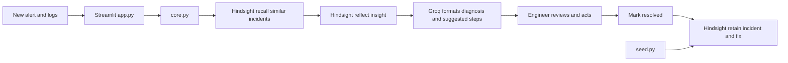

# OnCall Memory

On-call engineers often re-debug recurring incidents because past fixes are forgotten.
OnCall Memory uses Hindsight to retain resolved incidents and recall similar history for new alerts.
It uses that history to suggest a fix that worked before; engineers verify and apply it.

## How Hindsight is used

- **Retain:** [`seed.py`](seed.py) loads synthetic postmortems; the app's **Mark resolved** flow in [`app.py`](app.py) saves a resolved incident and its fix.
- **Recall:** [`core.py`](core.py) asks Hindsight for incidents similar to a new alert.
- **Reflect:** [`core.py`](core.py) requests Hindsight's insight before formatting the memory-informed answer.

## Architecture

## Run from a clean clone

1. Install dependencies: `pip install -r requirements.txt`.
2. Copy `.env.example` to `.env` and set `HINDSIGHT_URL` and `GROQ_API_KEY`. Set `HINDSIGHT_API_KEY` if your Hindsight deployment requires it.
3. Seed the incident bank: `python seed.py`.
4. Start the app: `streamlit run app.py`.

The app uses the `oncall-v3` Hindsight bank.

## Dataset and evaluation

The repository includes 40 synthetic incidents in `data/incidents.json` and 10 held-out test incidents in `data/test_incidents.json`. The evaluation harness is in [`eval/run_eval.py`](eval/run_eval.py).

### Evaluation

Quick mode evaluated 10 held-out synthetic incidents. There were 0 errored runs.

| Mode | Root cause correct | Fix score (judge, 1-5) | Retrieval hit |
|---|---:|---:|---:|
| Memory OFF | 10/10 | 38/50 (avg 3.8) | n/a |
| Memory ON (40 incidents) | 8/10 | 34/50 (avg 3.4) | 9/10 |

Learning curve (Memory ON): with 0 incidents in memory, root cause was 0/10 because the system answered “no closely matching incident” instead of guessing. With 40 incidents, root cause was 8/10. Retrieval hit rate rose from 2/10 to 9/10. The N=10 and N=20 points were not run.

### Interpretation

Memory did not beat a plain LLM on root-cause accuracy or fix score in this test, probably because the synthetic root causes are common and an LLM guesses them well, while memory answers are constrained to recalled data. The value shown is traceability (naming the past incident and its recorded fix), 9/10 retrieval, and accuracy rising as memory grows.

### Caveats

Only 10 test cases were evaluated, using synthetic data and an LLM judge in a single run; there are no confidence intervals.

## Limitations

- The incident data is synthetic.
- The assistant suggests fixes; it does not apply them.
- Novel incidents have no matching history to draw on.

## Roadmap

- Add a **Worked / Didn't work** feedback loop using Hindsight retain and reflect.
- Improve memory-answer quality with fewer validator fallbacks.
- Run the full learning curve, including N=10 and N=20.
- Build a Slack bot.
